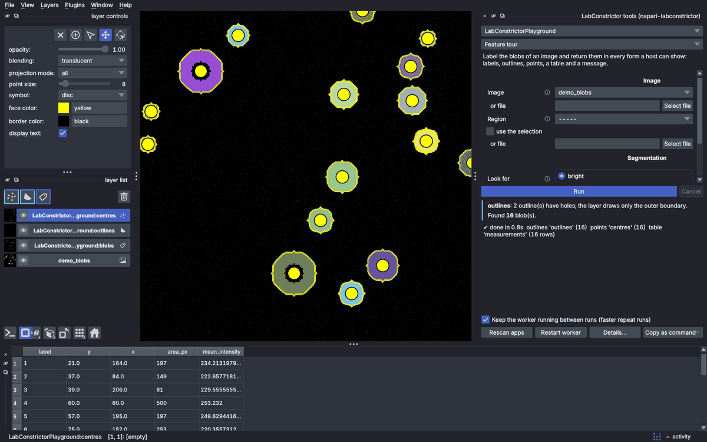
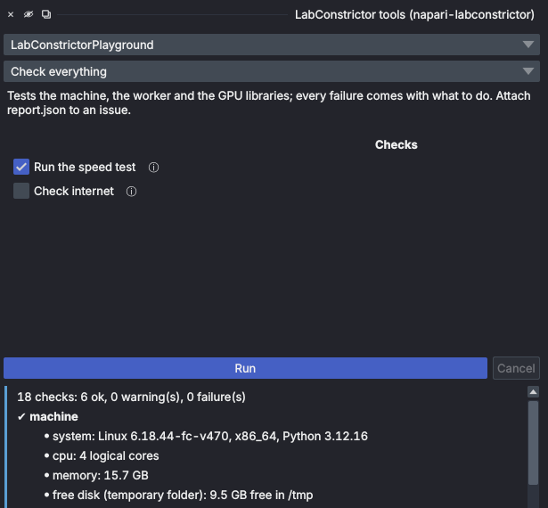

<div align="center">


# LabConstrictor Playground

**Is this computer, this installation and its GPU in order?** One button answers, and the answer can be pasted into an issue.

</div>

LabConstrictor Playground is a small test app. Its **Check everything** tool looks at your computer, the installation and the GPU libraries and tells you, line by line, what is fine and what to fix. Its other tools are small fixed examples for trying each feature of the LabConstrictor plugins in napari, Fiji and QuPath, with no scientific data needed. It is not a scientific analysis.



*The **Feature tour** tool in napari: one small segmentation that returns labels, outlines, points, a table and a message.*

## Install

Download the installer for your system from the [latest release](https://github.com/CellMigrationLab/LabConstrictor-Playground/releases/latest) (Windows, Apple Silicon Mac, Linux; Intel Macs are not supported) and run it. Step-by-step pictures: [Install an app](https://cellmigrationlab.github.io/LabConstrictor-Site/guides/install/).

The installer detects an NVIDIA GPU and installs the matching PyTorch (CUDA) build; if that fails it falls back to the CPU build and records what happened in its log, which **Check everything** reads back to you. Apple Silicon uses Metal ("mps") with the standard build.

## First use



1. Set up the plugin for the program you use: [napari](https://cellmigrationlab.github.io/LabConstrictor-Site/guides/napari/), [Fiji](https://cellmigrationlab.github.io/LabConstrictor-Site/guides/fiji/) or [QuPath](https://cellmigrationlab.github.io/LabConstrictor-Site/guides/qupath/).
2. Open the LabConstrictor tools there and pick **LabConstrictorPlayground**.
3. Run **Check everything**. You get a short readout, a table of details and a `report.json` file to attach to an issue.
4. Run **Feature tour** without choosing an image: it makes its own demo image and returns every kind of result.

Without any of these programs, from a terminal:

```
<install folder>/bin/python -m labconstrictor_tools run LabConstrictorPlayground check_everything
```

<br clear="right">

## Reading the answer

| Mark | Meaning |
|---|---|
| ✔ | fine |
| ⚠ | works, but something will bite later (low disk, a long path on Windows, the GPU build fell back to CPU) |
| ✖ | broken; the line below it says what to do (for example "the driver is too old for this CUDA build: update the NVIDIA driver") |

Honest limits: OpenCL on macOS is deprecated by Apple and ROCm (AMD) works on Linux only; this first version checks PyTorch only. TensorFlow is checked inside the apps that use it.

## What a passing check means

A passing **Check everything** is a check of the installation and the machine: this computer, the worker, the GPU libraries and the installer's log. It does not test the napari, Fiji or QuPath plugins; for that, run the tools from each program.

## Getting help

- Guides: the [LabConstrictor website](https://cellmigrationlab.github.io/LabConstrictor-Site/).
- Bugs and questions: the [issue tracker](https://github.com/CellMigrationLab/LabConstrictor-Playground/issues). Attach the `report.json` of **Check everything**.

## The tools

| Tool | What it does |
|---|---|
| **Check everything** | Machine (memory, disk, write access, path problems), worker, GPU tools (`nvidia-smi`, Apple chip), PyTorch (CUDA, Apple Metal, ROCm), a speed test of the same convolution and matrix product on the CPU and every GPU (the results must agree), what the installer decided about the GPU build, and optionally the internet. Returns a readout, a table of details and the report file. |
| **List the devices** | `cpu`, `cuda:0`, `mps`, whatever PyTorch can use here. Feeds the device dropdown below. |
| **Run a small test on a device** | The same test on the device chosen in a dropdown (shows the dependent dropdown and real GPU use). |
| **Make test data** | Small files made from a seed: a 3-channel image (the first channel is 10 plus the nuclei, so its mean is above 10 and depends on the image size; the second and third are flat at 20 and 30) (a tool that receives the wrong channel is caught), an RGB image, labels, a time-lapse, a table of points. |
| **Feature tour** | One small segmentation that uses every control and output of the bridge: a channel picker, "use the selection" as a region, radio buttons and sliders, a folded group with a box that empties itself, and labels, outlines, points, a table and a message as results (each run replaces the last). Run it with no image to use a built-in demo image (round blobs, rings with a hole, blobs in two parts). |
| **Look inside a file** | A small text or JSON file (at most 1 MB) as the single-file input: the keys and plain values of a JSON file, or the number of lines of any other text. |
| **Summarise a table** | A CSV table as input: the count, mean, minimum and maximum of each numeric column, as a table plus the number of rows and columns. |
| **Count the pixels above a level** | A parameter that another one switches on: the pixel `level` is only meaningful in mode *fixed*, the `percentile` only in mode *percentile*; Napari greys the other out (Fiji shows both, and the tool accepts both). |
| **Area of the bright region** | An image with a linked pixel size: the host fills it from the image's calibration. There is no default stand-in: an unknown pixel size stops the run with a clear message instead of giving an area made with a guessed one. |
| **Align the centres of two images** | Returns a 3x3 transform (the translation that moves the intensity centre of one image onto that of the other) attached to the two images; a host shows the moved image on the reference. |
| **Stress: ...** | A big image, many points (up to 2 million), a slow run with progress, a crash, no memory, a tool that ignores Cancel. The host must survive each of them and say what happened. *Out of memory (simulated)* raises a labelled `MemoryError` without using any memory, the same on every system; *Real memory pressure (bounded, opt-in)* is a separate tool in which a child process really uses at most 512 MB. |

## For developers

`src/labconstrictor_playground` holds the code (`checks.py`, `data.py`, `stress.py`, `timing.py`, `tour.py`), `src/labconstrictor_playground_lc_tools` the tool declarations, `lc_tests/` the tool cases (see its README), `tests/` the unit tests (CI runs `pytest tests`). The checks themselves are in [labconstrictor-tools](https://github.com/CellMigrationLab/LabConstrictor-Tools) (`labconstrictor_tools.diagnostics`), so every app can reuse them.

To run the tests: `pip install pytest "git+https://github.com/CellMigrationLab/LabConstrictor-Tools@main"`, `pip install -e .`, then `pytest tests` (the device tests also need PyTorch). Built from the [LabConstrictor](https://github.com/CellMigrationLab/LabConstrictor) template.

License: [MIT](LICENSE).
